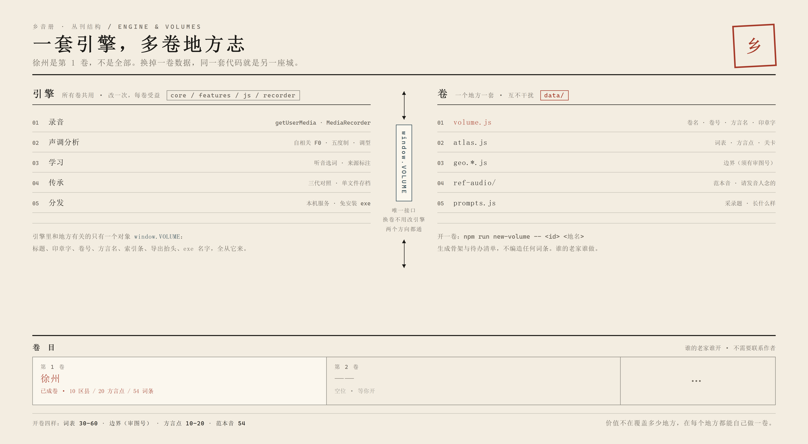

# 乡音册 · 徐州方言档案

> Dialect Atlas of Xuzhou — 一个可旋转、可探索的徐州方言 3D 数字地图

以 3D 彭城为核心，承载徐州 10 个区县、20 处方言点的方言词条、方言点与方言小游戏。纯前端实现，**无需构建、无需安装依赖**，双击 `index.html` 即可运行。

**徐州是第 1 卷，不是全部。** 引擎（录音 / 声调分析 / 学习 / 传承 / 导出 / 打包）与地方数据分开：
换掉 `data/volume.js` 与 `data/` 下的词表、边界、方言点、范本音，同一套代码就是另一座城。
开一卷：`npm run new-volume -- <卷 id> <地名>`。详见 **[VOLUMES.md](VOLUMES.md)**。



**许可**：代码以 MIT 授权；词条、拼音、例句、关卡与对话文本、缩略图以 CC BY-SA 4.0 授权；`data/geo.xuzhou.js` 的边界数据**来源待考、不主张授权**。详见 `LICENSE` 与 `NOTICE.md`。

## 功能

- **3D 地图**：基于 Three.js 构建的可旋转、可缩放的徐州城区模型，支持自动旋转与视角复位
- **方言点**：20 处方言点分类展示（语气词、亲属称谓等类型），点击查看详情
- **搜索**：顶部搜索框支持按区县、方言点、方言词检索（按 `/` 快速聚焦）
- **方言挑战**：词条测验模块，答对累计「方言值」与等级
- **拉呱场景**：3 段对话树（早点摊儿 / 街上问路 / 姥姥家吃饭），跟着话头接下去会解锁专属词条
- **方言图鉴**：已解锁词条一览（54 条全部可达），每张卡右下角一枚角标：`▶` 播你家的录音、`♪` 播范本音、`＋` 去录这个词
- **范本音**：请发音人照词条念一遍的"给定方言"教学录音。学习侧（听音选词）优先播它，其次是你家的录音，都没有才是合成音并标注出来。随包分发（放 `data/ref-audio/` + `npm run refs`）或由用户直接拖进词条册，两种都行
- **采录**（`recorder/`）：给词表与自家的说法录音，声调当场算成曲线与读数，存档是一个能脱离本程序打开的单文件 HTML。装上后「听发音」优先播**你家的真人录音**，没有录音时才回落合成音并明说那是普通话合成
- **探索进度**：底部队县导航 + 侧栏探索进度条

## 一卷一个地方

这不是"一个徐州 App"，是**一卷可以复制的地方志**。两层分得很干净：

| 层 | 文件 | 换一卷 |
|---|---|---|
| **引擎** | `core/` `features/` `css/` `js/` `recorder/` `tools/` `portable/` | 不动 |
| **卷** | `data/volume.js` `data/atlas.js` `data/geo.*.js` `data/ref-audio/` `recorder/prompts.js` | 全换 |
| 外壳 | `index.html` 里指向 `geo.*.js` 的那一行、`package.json` 的 name | 改一处 |

引擎里和地方有关的只有一个对象 `window.VOLUME`（见 `data/volume.js`）。跟着它变的：
顶栏品牌名、印章字、「第 N 卷」、浏览器标题、底部索引条、学习侧「这句××话的意思是？」、
导出存档的抬头、打出来的 exe 名字。

```
npm run new-volume -- suqian 宿迁     # 生成 volumes/suqian/：卷信息 + 待办清单
npm run volume                        # 卷体检：硬字段拦，来源字段提醒
npm run vol                           # 卷制回归：导入往返、坏输入、许可不继承（要本机 Chrome）
```

仓库里的 `volumes/suqian/` 就是这条命令的产物（一个空脚手架，不含任何编造的词条）。

**卷能搬**：地图顶栏「＋ 开一卷」→ 页面底部「导入已有的一卷」，把别人导出的 `.json` 拖进去。
导入会另存为新一卷、不覆盖已有的，**也不切走你当前这一卷**（报告里给一个「去看这一卷」才切）；
坏文件整份拒绝并逐条说原因（format 不对、片区 0/7 个、词表空、词重名、某条没写字），
一条都不写进本机。用户卷的许可也不继承第 1 卷的 CC BY-SA —— 没填就写「未声明 —— 仅本机自用」。

**一卷是能被走完的规模，不是数据库**：上限 500 个词、6 个片区。这条边界建在**数据层**
（`create()` / `update()` 直接返回 null），建卷页与导入只是两个更早报错的入口 ——
只守入口的话，下一个入口就会绕过，而绕过后这卷导得出去、导不回来。
超限整份拒绝，文案给数字与出口，不做部分导入。
片区重名自动标成 `城关 / 城关②` 并在报告里说明，不静默收下。

**为什么不做"全国一张图"**：语料要人一家家去录、边界要审图号，两千个县拼不成一张合规底图。
正确的形态是一套小引擎 + 很多个各自负责的卷。这个判断、成本估算、合规红线写在
**[VOLUMES.md](VOLUMES.md)**，要接手的人看那一篇就够。

## 快速开始

### 模式一 · 学习（双击即可）

```bash
# 直接打开，无需任何依赖
open index.html        # macOS
start index.html       # Windows
xdg-open index.html    # Linux
```

地图、搜索、方言挑战、拉呱场景、图鉴全部照常工作。**这个模式不能录音。**

### 模式二 · 学习 + 采录（要录你家的声音，就用这个）

```bash
node serve.cjs          # 或 node serve.cjs 8080，零依赖
```

| 入口 | 地址 |
|---|---|
| 学习（地图 / 挑战 / 图鉴） | http://127.0.0.1:8000/ |
| 采录 | http://127.0.0.1:8000/recorder/ |

工具条上新增的麦克风按钮 `#btnSample` 就是采录入口；它的数据流见下一节。

> 为什么录音必须走 `127.0.0.1`：浏览器**不会在 `file://` 来源授予麦克风权限**。
> 注意机制不是「`file://` 不安全上下文」——Chrome 里 `file://` 的 `isSecureContext` 实测为 `true`；
> 真正的原因是来源权限策略。所以自检判据看的是协议 + 主机，而不是 `isSecureContext`（这条是实测纠正的）。

## 两个模块之间的数据流

```
data/atlas.js  ──(ATLAS.words 54 条，唯一真源)──▶  recorder/prompts-atlas.js 派生成词表题（带 atlasId）
        ▲                                                        │
        │                                            录一条 → 存 IndexedDB xz-dialect-rec
        │                                                        │
   quiz.js「听发音」◀── features/sample.js ◀── localStorage 索引 xzdt.sample.v1
        ▲
        └── features/refs.js ◀── data/refs.js + data/ref-audio/（随包）
                             ◀── IndexedDB xz-dialect-refs（用户拖进来的）
```

- **词表 → 题库**：改 `atlas.js` 加一个词，采样台自动多一道题，两边不会漂移（实测合并后题库 42 → 93 题，其中 3 条与原有题目词形相同，改为把 `atlasId` 挂回原条目而不重复出题）。
- **题库 → 地图**：录音索引（不是音频）写进同源 localStorage；地图按 `atlasId` 找到 `clipId`，从 IndexedDB 取出 blob 播放。
- **「听发音」是一条优先链**：有你的真人录音 → 播录音并标注「真人录音 · 你家的说法」；没有 → 回落原来的普通话合成音，并明说**「这是普通话合成音，不是徐州话」**。合成音冒充方言是这个项目原来的天花板，现在它只在没有录音时出现，且不再冒充。

**隐私边界**：你自己录的东西全部留在本机浏览器里（IndexedDB + localStorage），本仓库**不含任何用户录音**，也没有任何上传路径。这些声音只随你自己导出的那个单文件 HTML 走，别把它放进公共仓库。

## 范本音：给学习侧一个真声音

学习侧原先唯一的"发音"是浏览器 TTS 的普通话——拿它学方言，等于在学普通话。范本音是真人念的徐州话，专门补这一环。

**两条来源，一个优先链**：

| 来源 | 放哪 | 归谁 |
|---|---|---|
| 随包分发 | `data/ref-audio/` + `npm run refs` 生成 `data/refs.js` | 你请发音人录的，跟着仓库/安装包走 |
| 用户导入 | 拖进词条册，或被「导入录音文件…」选中 | 只存在他自己的浏览器（IndexedDB `xz-dialect-refs`） |

**谁先播**（这是最容易做反的一处，所以写清楚）：

| 场景 | 顺序 |
|---|---|
| 学习（听音选词） | **范本音** → 你家的录音 → 合成音 |
| 地图词条 / 随便听听 | 你家的录音 → 范本音 → 合成音 |

道理是：学习要学的是"给定方言"怎么念，所以范本先播；而在词条里点"听发音"，你想要的多半是家里人怎么说。

**界面上必须能分出三种声音**，否则用户会把自己录的当成标准音：

| 标注 | 含义 | 颜色 |
|---|---|---|
| 范本音 · 徐州话 | 请发音人录的给定方言 | 靛 |
| 你家的录音 | 你自己录的 | 朱 |
| 有真人录音 · 点 ▶ 播放 | 有音源，但这次自动播放被浏览器拦了 | 朱 |
| 普通话合成 · 不是徐州话 | 两者都没有 | 灰 |

**加范本音**：把文件丢进 `data/ref-audio/`，在本目录跑 `npm run refs`。文件名用词条 id（`maozi.mp3`）、词本身（`茅子.mp3`）或带序号（`01-茅子.wav`）都认；对不上的会被列出来，不会静默丢弃。详见 `data/ref-audio/README.md`。

## 目录结构

```
.
├── index.html              # 页面骨架
├── serve.cjs               # 本地静态服务器（采录需要；地图与 recorder 同源）
├── css/
│   └── style.css           # 主样式
├── features/
│   ├── quiz.js / quiz.css   # 方言挑战（测验）模块
│   ├── refs.js              # 范本音（随包清单 + 用户导入，独立 IndexedDB 库）
│   ├── scene.js / scene.css # 拉呱场景（对话树运行时）
│   └── sample.js           # 采样台入口 + 真人发音优先链（读索引与 IndexedDB）
├── core/
│   ├── router.js           # 路由
│   ├── store.js            # 状态管理与进度持久化
│   └── volume.js           # 把 data/volume.js 落到页面（标题/印章/卷号/方言名）
├── data/
│   ├── atlas.js            # 方言词条与方言点数据（也是采样题库的真源）
│   ├── volume.js           # 这一卷的元信息 —— 换卷的接口
│   ├── refs.js             # 范本音清单（由 npm run refs 生成，别手改）
│   ├── ref-audio/          # 范本音音频（随包分发的那部分）
│   └── geo.xuzhou.js       # 徐州地理边界数据
├── js/
│   └── app.js              # 应用主逻辑
├── recorder/               # 采录（出题 → 录音 → 声调读数 → 标注 → 自包含存档）
│   ├── index.html / app.js / prompts.js / prompts-atlas.js
│   └── tools/              # selftest / e2e-check / anchor-check / extract / cross-check
├── volumes/                # 其他卷的脚手架（npm run new-volume 的产物）
├── tools/
│   ├── audit-reachability.cjs  # 静态守卫：有没有词条拿不到、场景有没有入口
│   ├── check-volume.cjs    # 卷体检：硬字段拦、来源字段提醒（npm run volume）
│   ├── scan-refs.cjs       # 扫 data/ref-audio/ 生成 data/refs.js（npm run refs）
│   └── new-volume.cjs      # 生成下一卷的骨架（npm run new-volume）
├── assets/thumbs/          # 各区县缩略图（SVG）
└── vendor/
    ├── three.min.js        # Three.js
    └── OrbitControls.js    # 轨道控制器
```

## 自检

改数据或改解锁通路之后跑一次（零依赖，`node` 直接跑）：

```bash
node tools/audit-reachability.cjs   # 退出码 0 = 54 条词条全部有已实现的解锁通路
```

它盯三件事：词条是否至少有一条**已实现**的通路（关卡 / 场景 / 到访）、场景 `unlock`
是否指向存在的词条、场景归属的区县是否存在（区县不存在则入口渲染不出来）。

改采录（`recorder/`）之后跑这几套：

```bash
cd recorder
node tools/selftest.cjs           # 声学判据：参考信号的 F0 偏差、平调判"平"、静音报红…
node tools/anchor-check.cjs       # 三段可独立求值的代码能否按标记稳定提取（不再依赖行号）
node tools/e2e-check.cjs 8143     # 端到端：起浏览器 + 假麦克风，真保存 / 真刷新 / 真删除 / 真导出
node tools/cross-browser.cjs      # 跨浏览器：本机每个可自动化的浏览器各跑一遍，出矩阵
```

> `e2e-check` 若在仓库根已起 `serve.cjs` 的端口上运行，会直接复用那个服务器并访问 `/recorder/`，
> 这才是合并后的真实拓扑（地图与采样台同源，索引才读得到）。
> 默认用 Chrome，`node tools/e2e-check.cjs 8143 edge` 可换浏览器；`node tools/browsers.cjs` 看本机装了哪些。
> Firefox / Safari 本机无法自动化（前者 CDP 已移除、后者仅 macOS），README 的「浏览器支持」一节写清了
> 代码为它们做了哪些降级，以及哪些只是"没跑过"——不拿 Chromium 的绿冒充全兼容。

## 怎么演示（含换机器）

录音只活在**浏览器**里（IndexedDB + localStorage），不在 exe、不在仓库 —— 这是隐私设计，
也意味着换台电脑就"没有录音"。演示分两种，按场合选：

| 场合 | 用什么 | 为什么 |
|---|---|---|
| 只演示「听完 / 存档」 | 采录页「导出单文件存档」 | 那是一个 HTML，**音频已以 base64 内嵌**，双击就能播，不需要本程序、不需要联网 |
| 要在**地图里点词条听自家录音** | 采录页「导出演示包（含录音）」→ 演示机「导入演示包」 | 录音与索引一起还原，`▶ 播真人录音` 才有东西可播 |
| 现场重新录一条 | 同一台机器、同一个浏览器 | 只要不清站点数据、不换浏览器，录音就一直在 |

**上台照着一页纸走**：[docs/演示脚本-5分钟.md](docs/演示脚本-5分钟.md) ——
含演示前 10 分钟清单、七个分镜（点哪里 / 说什么）、三种翻车对策、三个可能被问到的问题。

**演示包的走法**（30 秒）：

1. 在自己机器上打开采录页 → 「导出演示包（含录音）」→ 得到一个 `演示包-徐州-日期.json`；
2. 拷到演示机，双击 exe 打开 → 采录页 → 「导入演示包」选那个文件；
3. 回地图点开一个词，[你家的说法] 里就能播了。

包里是 `{format:'xiangyince-demo/1', volumeName, clips:[…, data:base64]}`，
只带声音、不带卷（卷有自己的导入通道，在开一卷页）。导入时按**词**重新对题，不按题号 ——
两个卷的题号一定不同，但「茅子」还是「茅子」；对不上的词仍会收下，只是不会出现在地图词条里，
界面会告诉你差哪几条。

> 演示前请确认：同一台机器上**不要清浏览器站点数据**、不要换浏览器（Edge 与 Chrome 各存一份）。
> 清之前先导一个演示包，30 秒的事。

## 打包给别人（免安装 exe）

```bash
node tools/build-portable.cjs     # 或 npm run build:portable
```

产物在 `dist/`：

| 文件 | 说明 |
|---|---|
| `乡音册.exe` | 单文件（约 84 MB），双击即用。内置 Node 运行时 + 全部静态资源 + 一个只监听 `127.0.0.1` 的静态服务器 |
| `使用说明.txt` | 给接收方看的一页说明 |
| `乡音册-免安装.zip` | 上面两个打成的包（约 32 MB），适合微信/邮件传输 |

为什么要裹一个 exe：**浏览器不会在 `file://` 下给麦克风**，双击 HTML 只能看不能录。
exe 启动时在本机起服务、再用默认浏览器打开 `http://127.0.0.1:8000/`，
这才是能录音的来源；关掉那个命令行窗口，服务即停止。录音仍然只存在使用者本机浏览器里。

`node tools/build-portable.cjs` 会在打包后自动跑一次 `--self-test`（起服务、取首页/采样台/脚本/three.js，
全部 200 且内容命中才算过），避免发出一个打不开的 exe。

**图标**：`node portable/make-icon.cjs`（或 `npm run icon`）会用本机 Chromium 按 16/24/32/48/64/128/256
七个尺寸各渲染一次「朱色方章 + 徐」，拼成 `portable/icon.ico`；打包时自动写进 exe。
不用 Pillow、不用 ImageMagick——本机已有的浏览器就够了。

**其他平台**：

| 平台 | 怎么做 | 状态 |
|---|---|---|
| Windows x64 | `node tools/build-portable.cjs` | 已验证（自检 + 端到端录音） |
| macOS（Intel / Apple Silicon） | 在**目标机器**上跑同一条命令；脚本会自动 `codesign --remove-signature`、注入时加 `--macho-segment-name`、装完再做 ad-hoc 签名 | 代码里有分支，**未在真机验证** |
| Linux x64 | 同上（无需签名步骤） | 代码里有分支，**未在真机验证** |

跨架构不行：打进去的是**本机**的 Node 运行时，arm64 的包只能在 arm64 上跑。

## 相关仓库

- [xz-dialect-geo-data](https://github.com/22258-cmd/xz-dialect-geo-data) — 地理边界数据（权威版与降采样版）
- [xuzhou-dialect-duel](https://github.com/22258-cmd/xuzhou-dialect-duel) — 徐州方言对决概念方案页

## 说明

方言资料整理自公开的地方志与民俗资料，仅供学习与文化展示参考，具体读音与用法请以当地使用者为准。
