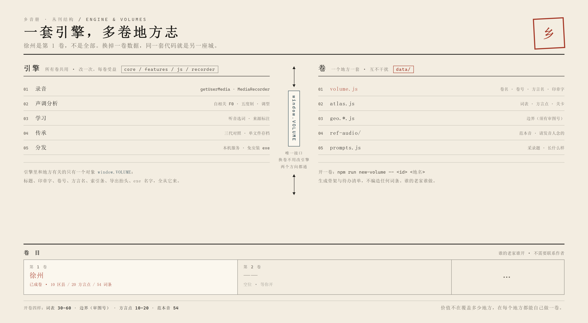

# 一卷一个地方：怎么把《乡音册》复制到你的家乡

> 这一篇不是功能说明，是**项目的边界与野心**。
> 如果只想知道怎么用，看 `README.md`。

## 一、先说结论

《乡音册》不是一个徐州 App，是**一卷可以复制的地方志**。

- 徐州是**第 1 卷**，不是全部；
- 引擎（录音、声调分析、学习、传承、导出、打包）与地方数据是**分开的两层**；
- 换一卷，引擎一行不改 —— 这不是口头承诺，`data/volume.js` 就是那个接口，
  `npm run new-volume` 就是那条命令。

**为什么不做"全国一张图"**：不是技术做不到，是三件事不划算。

| 事 | 为什么不能规模复制 |
|---|---|
| 语料 | 一个县 30–60 个词、要当地人核。全国 2800 多个县级区，这是人年，不是人天 |
| 发音人 | 每个点都得有人愿意念、且同意公开。这件事没有捷径，也不该有 |
| 地图 | 中国地图必须用有审图号的标准底图。一张全国底图能合规，两千张县级拼图不能 |

所以正确的形态不是"一个大产品"，是**一套小引擎 + 很多个各自负责的卷**。
谁的老家谁来做，做完可以互相对照 —— 这才是方言地图该有的组织方式。



## 二、两层怎么分

| 层 | 文件 | 换一卷要不要动 |
|---|---|---|
| **引擎** | `core/` `features/` `css/` `js/` `recorder/` `tools/` `portable/` | **不动** |
| **卷** | `data/volume.js` `data/atlas.js` `data/geo.*.js` `data/ref-audio/` `recorder/prompts.js` | 全换 |
| 外壳 | `index.html`（一行 script 指向哪个 geo）、`package.json` 的 name | 改一处 |

引擎里**唯一**和"地方"有关的东西是 `window.VOLUME` 这个对象：

```js
window.VOLUME = {
  id: 'xuzhou', no: 1, title: '乡音册',
  name: '徐州', dialect: '徐州话', mark: '乡',
  scope: '10 个区县 · 20 处方言点 · 54 个词条',
  dataLicense: 'CC BY-SA 4.0',
  refsBy: '', survey: '', mapSource: ''
};
```

页面上这些都会跟着它变，不用改 HTML：

| 位置 | 取的值 |
|---|---|
| 浏览器标题、分享卡片的描述 | `title` + `name` |
| 顶栏品牌名 / 印章字 / 「第 N 卷」 | `title` / `mark` / `no` |
| 底部索引条「徐州 · 10 区县」 | `name` + 数据里的区县数 |
| 学习侧「这句××话的意思是？」「范本音 · ××话」 | `dialect` |
| 「关于本卷」那张卡 | 全部字段 |
| 导出的存档抬头、打出来的 exe 名字 | `name` / `title` |

实测：把 `data/volume.js` 换成宿迁（其余不动），标题、卷号、副标题、印章字、
底部索引条、学习侧问句六处同时跟着变，引擎零改动。
（脚本在 `out/verify-volume.cjs`；仓库里 `npm run volume` 是它的静态版守门。）

## 三、开一卷：五步

```bash
npm run new-volume -- suqian 宿迁          # 生成 volumes/suqian/（volume.js + README）
# 备齐词表 / 边界 / 方言点 / 范本音
cp volumes/suqian/volume.js data/volume.js  # 换卷
npm run volume                              # 卷体检：缺什么它会说
npm run audit && (cd recorder && node tools/selftest.cjs)
```

生成器只给骨架，**不编造任何词条**。这一卷成不成，取决于你找到的发音人。

## 四、一卷大概要多少成本

诚实估：**15–30 人天**，其中八成不在写代码。

| 环节 | 人天 | 说明 |
|---|---|---|
| 词表 | 5–10 | 查方言志 2–3 天，找当地人核每个词 3–7 天。**这是唯一不能省的** |
| 边界与方言点 | 2–4 | 用标准底图取边界；方言点靠地方志或实地 |
| 录音 | 3–5 | 1 位发音人 × 54 词 ≈ 半天，但要校对、重录、命名 |
| 接入与调试 | 2–3 | 换数据、跑测试、修被数据带坏的地方 |
| 发布 | 1–2 | 审图号、授权、致谢名单 |

一个县的真实工作量，和"做一个 App"不是一个量级 —— 这也是为什么要分成卷。

## 五、两条不能省的红线

**1. 地图合规。** 中国地图必须用有审图号的标准底图（民政部标准地图 / 天地图）。
自己描的边界本地做演示可以，**一旦公开上线，边界不合规是硬风险**。
`data/volume.js` 里 `mapSource` 那一栏不是装饰：填不出来，就别发布。

**2. 发音人同意。** 录音前说清三件事：用途、会不会公开、能不能撤回。
没有书面同意就不要收。**人给了声音，不等于把声音的所有权给了你。**
范本音清单里最好写明谁念的（`refsBy`），那是起码的署名。

## 六、怎么接力

- **开自己的卷**：fork 之后只碰 `data/`、`volumes/<你的 id>/`、`index.html` 一行。
  这样上下游都能合。
- **改引擎**：改的是所有卷都受益的东西（兼容性、声调算法、导出格式）。
  改完请跑 `recorder/tools/cross-browser.cjs`，别让别人的卷因为你的改动变红。
- **别做的**：把别人的录音打包进你的卷；把"某地方言很土"当卖点；用合成音冒充方言。

## 七、现在已经到哪一步（自评，不吹）

| 能力 | 状态 |
|---|---|
| 引擎与卷分离 | ✅ `data/volume.js` 为唯一接口，实测换卷 6 处联动 |
| 开卷脚手架 | ✅ `npm run new-volume`，产物含卷信息与待办清单 |
| 卷体检 | ✅ `npm run volume`：硬字段拦，来源字段提醒 |
| 录音 → 声调 → 导出 | ✅ 单卷已验证（Chrome/Edge 各 22 项 + 导出 4 项） |
| 学习侧真人方言 | ⚠️ 机制就绪（范本音），**徐州卷还没有一条真录音** |
| 多卷共存 / 互相跳转 | ❌ 没做，也不建议现在做 —— 先把第 2 卷立起来再谈 |
| 全国底图 | ❌ 不该做，见第一节 |

最后一行最重要：**这套东西的价值不在"覆盖多少地方"，在"每个地方都能自己做一卷"。**
